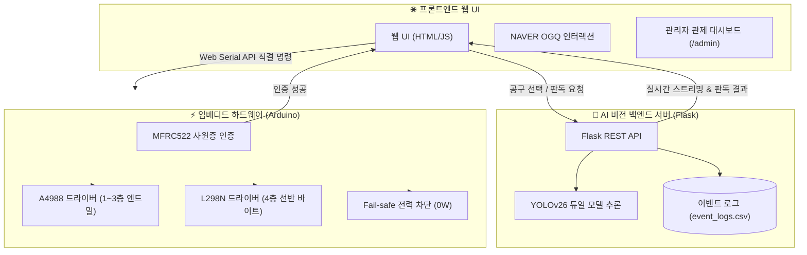

# 🏆 AI 스마트 공구 자판기 (AI Smart Endmill Vending Machine)

**제4회 NAVER OGQ마켓 AI Competition - AI × 산업 혁신 트랙 출품작**  
**Team:** 툴토리얼 (Tooltorial) | **소속:** 부산기계공업고등학교

## 🚀 바로 확인해 보세요! (Demo & Video)
🎮 **[100% 가상 체험 데모 웹사이트 접속하기](https://sgsgsg26.github.io/tooltorial-ui/)**  
*(파이썬 서버나 아두이노 하드웨어 없이도 브라우저에서 바로 툴토리얼의 UI와 OGQ 스티커 연동을 체험해 보실 수 있습니다!)*

🎬 **[5분 시연 및 발표 영상 보기 (YouTube)](https://www.youtube.com/watch?v=2LQ3BjfSXB4)**
🎬 **[2차 데모데이 발표 영상 보기 (YouTube)](https://youtu.be/-GfRm83LN8M?si=pbl5BtV8U6xLZvxM)**

---

## 1. 🚨 문제 정의 및 MVP 범위 (Problem & Scope)

### 1.1 문제 정의 (Mission)
제조 산업 현장과 공업고등학교 실습실의 핵심인 공작기계 공정에서 정밀함을 좌우하는 '엔드밀 및 선반 바이트' 관리는 여전히 아날로그 방식에 머물러 있습니다.
* **안전 및 보관 문제:** 날카롭고 값비싼 공구들이 일반 공구함에 수북이 겹쳐 보관되어 작업자가 손을 베이는 안전사고가 빈번하며, 공구끼리 부딪혀 사용 전부터 날이 손상됩니다.
* **주관적 육안 검사의 한계:** 공구 파손 상태를 작업자의 주관적 판단이나 손끝 감각에 의존하여 가공 치수 불량이 발생하거나, 아직 쓸 수 있는 공구를 조기 폐기하여 막대한 예산 손실을 초래합니다.

### 1.2 MVP 범위표
* **핵심 행동 1문장:** 사용자가 사원증(RFID)을 태그하여 공구를 선택하면, 자판기가 공구를 1개씩 자동 배출하고 AI가 실시간으로 공구의 마모/파손 상태를 3단계로 객관적 판별하여 피드백을 제공한다.
* **이번에 만든 것 (MVP 포함):** 
  - 웹 브라우저 ↔ 아두이노 직접 제어를 위한 **Web Serial API 직결 통신**
  - 실시간 웹캠 스트리밍 및 **YOLOv26 커스텀 듀얼 모델(엔드밀/바이트 분리)** 기반 3단계 정밀 상태 판별
  - RFID 태그 인증 및 복합 모터 드라이버(A4988 + L298N)를 활용한 물리적 배출 자동화
  - **NAVER OGQ마켓 API를 연동한 작업자 친화적 감성 인터랙션 UX 구현**
  - **재고 파악 및 불량 통계를 위한 실시간 관리자 전용 웹 대시보드 (`/admin`)**
  - 모터 화재 위험 원천 차단을 위한 **소프트웨어 펌웨어 Power-cut 로직**
* **이번에 안 만든 것 (MVP 제외):**
  - 복잡한 회원가입 절차 (오프라인 사원증 RFID 태그 방식으로 현장 즉시성 확보)

---

## 2. 💡 핵심 솔루션 및 차별점 (Core Solution & UX)
YOLOv26 비전 AI와 아두이노 하드웨어 제어를 결합하여, **불량 공구를 객관적으로 걸러내고 안전하게 자동 배출하는 스마트 팩토리형 공구 자판기 시스템**입니다.

* **듀얼 비전 AI 상태 판별:** 형상이 다른 엔드밀과 선반 바이트를 위해 전용 듀얼 모델을 분리 구축하여, 웹캠을 통해 공구 상태를 **[양품 / 1날 파손(주의) / 2날 이상 파손(폐기)]** 3단계로 실시간 객체 탐지합니다.
* **스마트 자동 배출:** Web Serial API를 활용해 웹 브라우저에서 아두이노를 직접 제어하며, RFID 인증을 거쳐 지정된 층의 공구를 스텝 모터로 안전하게 밀어냅니다.

### ✨ [포인트 1] 실시간 통계 시스템 : 관리자 전용 웹 대시보드 (`/admin`)
단순 자판기를 넘어 '데이터 기반 실습실 관제 시스템'으로 거듭나기 위해 관리자 모드를 구축했습니다.
* **실시간 데이터 로깅:** 작업자의 사원증 접속, 배출 시도, AI 판독 결과가 실시간으로 서버의 `event_logs.csv`에 자동 기록됩니다.
* **재고 및 불량 관리:** 층별 공구 재고 부족 알림(Alert), 시간대별 사용량 꺾은선 그래프, AI 판독 기반의 파손 통계 도넛 차트를 2초 주기로 자동 갱신합니다.

### ✨ [포인트 2] NAVER OGQ API 연동을 통한 작업자 친화적 UX 구축
단순하고 거친 산업용 기계를 넘어, 감성적인 UX를 제공하기 위해 **NAVER OGQ마켓 API**를 프론트엔드에 연동했습니다.
* **사원증 태그 리액션:** 공구 대여 시 작업자의 사원증에 귀여운 OGQ 캐릭터 프로필이 노출되어 친근함을 줍니다.
* **대기 시간 및 결과 피드백:** 공구 배출 대기 시간(약 3~4초) 동안 동적 OGQ 스티커가 팝업되어 사용자의 조작 오류나 중도 이탈을 원천 차단하고, AI 판독 결과에 맞춰 직관적인 감성 피드백을 제공합니다.

---

## 3. 📈 도입 전/후 기대 효과 (정량적 성과)
*시범 운영 기간(3일) 동안 실습실 현장 실제 로그(`event_logs.csv`, 총 240건) 기반 측정*

| 항목 | 도입 전 (기존 수작업) | 도입 후 (툴토리얼 시스템) | 개선 효과 |
|---|---|---|---|
| ⏱️ **공구 재고 파악 시간** | 일일 약 20분 (수기 전수조사) | **실시간 2초 주기 자동 갱신** | **업무 시간 99% 이상 절감** |
| 🛡️ **손 베임 안전사고 위험** | 상시 노출 (육안/촉감 검사) | **0% (비전 AI 자동 판별)** | **안전사고 위험 원천 제거** |
| 🔍 **AI 모델 판별 정밀도** | 주관적 판단 (휴먼 에러 빈번) | **엔드밀 99.7% / 바이트 99.8%** | **불량품 혼입 방지 극대화** |
| 🔥 **모터 대기 발열 화재 위험** | 상시 전류 소모로 과열 위험 | **0W 완전 차단 (Power-cut 로직)** | **장시간 무인 운영 안정성 확보** |

---

## 4. 🏗️ 시스템 아키텍처 및 동작 흐름 (Architecture)

GitHub에서 깨짐 없이 반응형으로 렌더링되도록 시각화 다이어그램으로 구성했습니다.



### 동작 흐름 요약
1. **인증 단계:** 작업자가 RC522 리더기에 사원증(RFID) 태그 ➔ 웹 UI에 사용자 프로필 및 배출 가능 품목 활성화
2. **배출 단계:** 웹 UI에서 원하는 공구(1~4층) 터치 ➔ Web Serial API로 아두이노에 모터 구동 명령 직결 전송 ➔ 스텝 모터가 해당 공구를 1개 정밀 배출 ➔ 배출 완료 즉시 모터 전류 차단(Power-cut)
3. **판독 단계:** 반납된 공구를 웹캠에 비춤 ➔ Flask 백엔드에서 YOLOv26 듀얼 모델(엔드밀/바이트)이 마모 상태를 3단계로 실시간 판별 ➔ 판독 결과와 OGQ 스티커가 화면에 동시 표출
4. **관제 단계:** 대여, 배출, AI 판독 등 모든 이벤트가 `event_logs.csv`에 기록되고 관리자 대시보드(`/admin`)에 실시간 반영

---

## 5. 🛠️ 기술 스택 (Tech Stack)
* **AI Model:** `Ultralytics YOLOv26n` (커스텀 데이터셋 파인튜닝), `OpenCV` (영상 프레임 제어)
* **Backend:** `Python 3.10+`, `Flask` (YOLO 추론 및 실시간 영상 스트리밍 API 서버)
* **Frontend:** `HTML5`, `CSS3`, `JavaScript (ES6+)`, `Web Serial API`, `Chart.js`, `NAVER OGQ Market API`
* **Hardware:** `Arduino Uno`, `CNC Shield v3`, `L298N 모터 드라이버`, `NEMA 17 스텝 모터`(4ea), `RC522 RFID 모듈`
* **Dataset & Tools:** `Roboflow`, `NVIDIA RTX 4060 (CUDA 12.x)`

---

## 6. 🧠 AI 모델 학습 상세 (AI Usage & Training)
공구의 형태적 특성(나선형 홈 vs 사각 자루형 팁) 차이로 인한 상호 간섭을 방지하기 위해 **듀얼 전용 모델(Dual Model Architecture)**로 설계하여 학습을 진행했습니다.

* **베이스 모델:** Ultralytics YOLOv26n (경량화 모델로 로컬 온디바이스 실시간 추론 최적화)
* **모델 1: 엔드밀 전용 모델 (`endmill_yolo26`)**
  - **클래스 (9종):** 16파이·14파이·12파이 규격별 `양품(0)`, `날 1개 파손(1)`, `날 2개 이상 파손(2)`
  - **학습 결과:** 50 Epoch 완주, **정밀도(Precision) 99.7%, 재현율(Recall) 98.9%, mAP50 99.1%**
* **모델 2: 선반 황삭 바이트 전용 모델 (`lathe_yolo26`)**
  - **클래스 (3종):** `양품(lathe_0)`, `날 1개 파손(lathe_1)`, `날 2개 이상 파손(lathe_2)`
  - **학습 결과:** 50 Epoch 완주, **정밀도(Precision) 99.8%, 재현율(Recall) 100%, mAP50 99.5%**
*(상세 학습 가중치와 검증 지표는 저장소의 `runs/detect` 폴더 참조)*

---

## 7. ⚙️ 하드웨어 트러블슈팅 (Hardware Engineering)
* **선반 바이트 배출 모터 독립 제어 (L298N 도입):** 초기 소형 드라이버(A4988) 구동 시 무거운 선반 바이트(4층) 하중으로 인해 모터가 제자리에서 떨기만 하는 탈조 현상이 발생했습니다. 4층 전용으로 허용 전류가 높은 **고출력 L298N 드라이버**를 독립 추가하여 배출 토크를 완벽히 확보했습니다.
* **스텝 모터 화재 위험 원천 차단 (소프트웨어 Power-cut):** L298N 도입 후 대기 상태에서 지속 전류로 모터가 과열되는 심각한 문제를 확인했습니다. 배출 동작이 끝나는 즉시 핀 출력을 0으로 내리는 **`digitalWrite(A0~A3, LOW)` 전력 차단 로직**을 펌웨어에 적용하여 대기 전력 0W 및 화재 위험을 100% 제거했습니다.
* **얇은 엔드밀 중복 배출 방지 (Quantity Control):** 직경이 얇은 엔드밀이 간혹 2개씩 겹쳐 나오는 물리적 오차를 방지하기 위해, 나선 축 모터 스텝 회전 각도(초기 설정값)를 1개 배출에 맞게 정밀 보정하는 수량 제어 알고리즘을 적용했습니다.
* **3D 프린팅 전용 배선 제어함 제작:** 전선 쇼트 방지 및 실습실 환경 보호를 위해 전용 하드웨어 제어 케이스를 직접 설계·출력하여 장착했습니다.

---

## 8. 🚀 실행 방법 (How to Run)

### 하드웨어 세팅
1. 파워서플라이 전원을 켭니다. (12V 3~5A 인가)
2. Arduino IDE를 이용해 `VendingMachineRFID/VendingMachineRFID.ino`를 업로드합니다.

### 소프트웨어 서버 구동
1. 저장소 클론 및 환경 설정:
   ```bash
   git clone https://github.com/sgsgsg26/Tooltorial.git
   cd Tooltorial
   cp .env.example .env
   # .env 파일 내 OGQ_API_KEY 입력
   ```
2. 파이썬 가상환경 구성 및 패키지 설치:
   ```bash
   pip install -r requirements.txt
   python app.py
   ```
3. 브라우저 접속:
   - **사용자 배출 UI:** `http://localhost:5000/ogq-vending-ui.html`
   - **관리자 대시보드:** `http://localhost:5000/admin` *(별도 로그인 없이 즉시 모니터링 가능)*

---

## 9. ⚖️ 외부 사용 내역 및 오픈소스 라이선스
본 프로젝트는 대회 규정을 철저히 준수하여 아래의 오픈소스 및 외부 자원을 명시합니다.

* **비전 AI 모델:** Ultralytics YOLOv26 (AGPL-3.0 License)
* **오픈소스 라이브러리:** OpenCV (Apache 2.0), Flask (BSD-3-Clause), Chart.js (MIT)
* **외부 서비스 연동:** NAVER OGQ Market API (디지털 에셋 연동), Roboflow (데이터 라벨링)
* **코드 생성 보조 AI:** Claude & Gemini (하드웨어 제어 알고리즘 및 웹 UI 로직 작성 보조)
* **현장 인터뷰 및 자문:** 부산기계공업고등학교 기계과 실습 담당 교사 3분

---

## 10. 🔒 보안 및 개인정보 보호
- **API Key 보안 관리:** NAVER OGQ API Key 등 민감 정보는 `.env` 환경변수로 분리하여 GitHub 유출을 원천 차단했습니다.
- **로컬 온디바이스 운영:** 학생증 RFID 식별자 및 비전 판독 영상은 외부 클라우드로 전송되지 않고 실습실 로컬 PC 내에서만 안전하게 처리됩니다.
- - **실제 학생 개인정보 미포함 (`event_logs.csv` 비식별 마스킹 처리):** 저장소에 포함된 `event_logs.csv`에는 실제 학생의 실명·학번 등 개인 식별 정보(PII)가 일절 포함되지 않습니다. 기존 로그에 표기되었던 `'부기공'`은 특정 학생의 실명이 아니라 소속 학교인 **'부산기계공업고등학교'의 약칭**이며, 공개 저장소 업로드 시 미성년 학생들의 개인정보 보호를 위해 공통 익명 가명으로 마스킹하여 기록한 것입니다. (외부에서 인명으로 오인할 소지를 없애기 위해 현재 로그의 `user_id`를 `NAVER OGQ 사원 (익명_부기공)`으로 명확히 표기하였습니다.)
